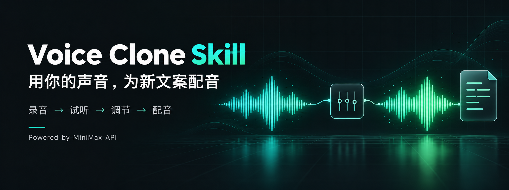

# Voice Clone Skill · 声音克隆工作流



**文案改了，不用重新开麦。让 AI 助手用你的克隆音色，为新文案生成配音。**

这套 Skill 基于 MiniMax API，把录音上传、音色克隆、试听、韵律调整、费用确认和音频交付整理成可重复使用的流程。适合知识视频、课程旁白和日常内容创作。

## 它能做什么

- 用本人的清晰录音建立音色，并交付试听。
- 把新文案转换成自己的音色配音。
- 调整语速、情绪、停顿、发音和音色参数。
- 先确认韵律和预估费用，再发起合成。
- 管理本地音色记录，支持长文本异步合成。

底层声音克隆与语音合成由 **MiniMax** 提供；本项目负责组织流程、调用接口与交付文件。输出是音频，不自动生成视频。

## 支持哪些 AI 助手

可供 Codex、WorkBuddy、豆包工作等支持本地 Skill 的助手接入。实际运行需要同时具备：读取 `SKILL.md`、执行本地 Python、访问 MiniMax API，以及读取用户提供的音频文件。各客户端安装方式与权限不同，需分别验证；仅粘贴提示词不会让不支持 Skill 的客户端获得这些能力。

## 安装

1. 下载本仓库（GitHub 页面 **Code → Download ZIP**），或克隆：

   ```bash
   git clone https://github.com/Newdvn2025/minimax-voice-clone-skill.git
   ```

2. 将完整的 `voice-clone/` 文件夹放到 AI 助手的技能目录，保留 `SKILL.md` 与 `scripts/` 的相对位置。

   Codex 的常见安装位置是 `~/.codex/skills/voice-clone/`。WorkBuddy、豆包工作请使用各自提供的 Skill 导入或技能目录功能。安装后重新打开会话或刷新技能列表。

3. 准备 **Python 3.10+**。脚本仅使用 Python 标准库，无必装第三方 Python 依赖；音频预处理与时长检查可选安装 `ffmpeg`。

4. 在 MiniMax 国内站注册并完成所需认证，取得自己的 API Key。默认接口地址为 `https://api.minimax.cn`。在助手能够读取的运行环境中配置：

   ```bash
   export MINIMAX_API_KEY='YOUR_API_KEY'
   ```

   不要把真实 Key 发到评论区、提交 GitHub 或写进公开文件。`.env.example` 仅为变量示例，脚本不会自动加载 `.env`；从桌面启动的客户端可能需要单独设置运行环境。

## 一句话调用

安装并配置好环境后，把录音交给助手，再输入：

> 调用 voice-clone 技能，用我上传的本人录音克隆声音，先给我试听。满意后为文案配音，合成前让我确认情绪、停顿和预估费用。

已经有满意的克隆音色时：

> 调用 voice-clone 技能，用我的默认音色为下面的新文案生成配音。先给我确认语速、情绪、停顿和费用，再生成音频：〔在这里粘贴文案〕

想调整结果时：

> 语速慢一点，突出“我的声音”，句间停顿稍长。先给我看新的方案和费用，我确认后再生成。

## 使用流程

**本人录音 → 克隆试听 → 确认音色 → 输入新文案 → 确认韵律与费用 → 生成并交付音频**

录音要求：mp3、m4a 或 wav，10 秒至 5 分钟，不超过 20 MB。建议使用 30–60 秒的清晰单人录音，不带背景音乐。只使用自己的声音。

完整步骤、命令及参数见 [voice-clone/SKILL.md](voice-clone/SKILL.md)。所有脚本命令从 `voice-clone/` 目录执行。

## 费用说明

Skill 本身开源免费；**MiniMax API 调用由使用者自行付费**。

2026-10-11 官方价格参考：音色首次正式用于合成时收取 9.90 元/音色；Turbo 模型合成 2.00 元/万计费字符。中文一个汉字按两个计费字符计算，不能直接把“万计费字符”理解为“一万汉字”。克隆试听也有合成费用，重新生成会产生新的费用。

价格、可用模型、认证要求及服务规则以 [MiniMax 官方文档](https://platform.minimax.cn/docs/guides/pricing-paygo) 为准。设置默认音色不代表已经支付首次使用费用。

## 隐私与数据

- 参考录音及合成文本会提交到 MiniMax，使用前请确认可以上传。
- API Key 只从环境变量读取。
- `voices.json`、输入录音、输出音频、日志及缓存为运行时私有数据，已在 `.gitignore` 中排除。
- 仓库与发布压缩包不包含作者的 API Key、个人音色记录、私人录音或生成音频。
- 交付音频应注明 AI 合成配音。

## 项目结构

```text
voice-clone/
├── SKILL.md                 # AI 助手读取的工作流说明
└── scripts/                 # 上传、克隆、合成与音色管理脚本
assets/hero.png              # 项目封面
tests/test_regressions.py    # 离线回归测试
.env.example                # 空密钥环境变量示例
```

## 验证与限制

```bash
python3 -m unittest discover -s tests -v
```

公开版本通过离线回归测试及敏感信息扫描。离线测试不代表 MiniMax API 端到端验证；发布前未重新执行付费克隆、合成或删除请求。不同助手的实际接入能力需分别验证。

## 许可证

代码采用 [MIT License](LICENSE)。MiniMax 服务及生成内容的使用还需遵守其服务条款。本项目为独立开源项目。
